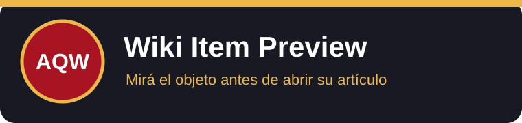
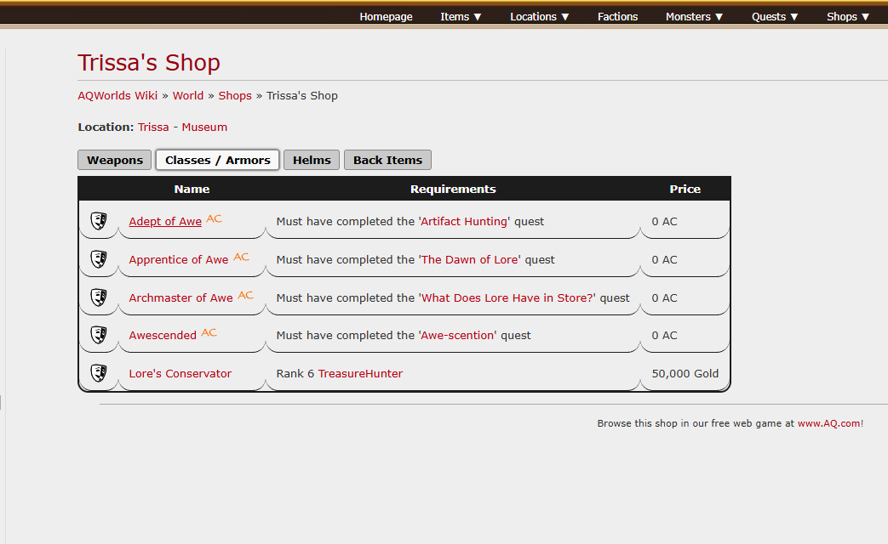
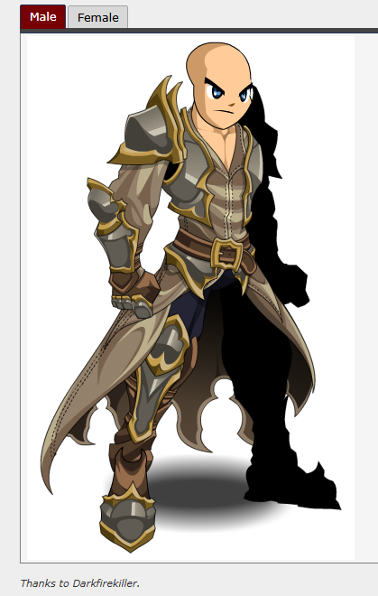

# AQW Wiki Item Preview



Extensión de Chrome que muestra imágenes de objetos en las tablas de [AQW Wiki](https://aqwwiki.wikidot.com/) y al dejar el mouse sobre sus enlaces. Por ejemplo, en [Trissa's Shop](https://aqwwiki.wikidot.com/trissa-s-shop) aparece una columna **Foto** junto a [Adept of Awe](https://aqwwiki.wikidot.com/adept-of-awe).

## Ejemplo

| Enlace en la tienda | Imagen del artículo enlazado |
| --- | --- |
|  |  |

Estas capturas muestran las páginas de referencia aportadas para el proyecto. La columna y la vista flotante se generan sobre la tienda; todavía no hay una captura de la extensión en funcionamiento.

## Qué hace

- Reconoce enlaces de artículos dentro del contenido de la wiki, incluso en pestañas de tiendas.
- Añade una columna **Foto** a las tablas de objetos con **Name** y **Price**. Carga todas las miniaturas, incluso en pestañas ocultas, con hasta tres consultas simultáneas.
- Consulta el artículo enlazado tras una pausa de 250 ms y muestra la primera imagen del objeto.
- Omite iconos de AC, rareza y categorías, además de páginas que no son fichas de objetos.
- Oculta la imagen al salir del enlace o desplazar la página. Conserva resultados en memoria durante la pestaña.

## Descarga

Descargá `aqw-wiki-item-preview-1.1.0.zip` desde el [release v1.1.0](https://github.com/GermanBartoli/aqw-wiki-item-preview/releases/tag/v1.1.0). Es una extensión descomprimida de Chrome, no un instalador.

## Instalación

1. Descargá el ZIP del release y descomprimilo.
2. Abrí `chrome://extensions` y activá **Modo desarrollador**.
3. Pulsá **Cargar descomprimida** y elegí la carpeta extraída.
4. Abrí o recargá una página de AQW Wiki.

## Desarrollo

Requiere Node.js 22 o posterior y PowerShell para generar el ZIP. No hay paquetes que instalar.

```sh
npm test
npm run build
npm run package
```

`dist/` es la carpeta para **Cargar descomprimida**. `releases/` contiene el ZIP. Ver [arquitectura](docs/arquitectura.md) y [verificación](docs/verificacion.md).

```text
src/core/           Selección de enlaces e imágenes
src/content/        Vista flotante, columna de fotos y caché compartida
assets/             Iconos de la extensión
tests/              Pruebas del analizador
scripts/            Build, iconos y paquete ZIP
docs/               Arquitectura, verificación e imágenes
.github/workflows/  Verificación automática
```

## Privacidad y límites

No requiere cuenta, configuración ni permisos fuera de `aqwwiki.wikidot.com`. La extensión no guarda datos ni usa telemetría. Consulta los artículos enlazados en las tablas de objetos al abrir la página y los demás al apuntar a sus enlaces. Carga las imágenes desde los hosts que esos artículos utilizan.

La selección usa la estructura actual de las fichas de AQW Wiki. Una página sin imagen útil, una imagen caída o un cambio de formato en la wiki pueden dejar la vista previa vacía. No está publicada en Chrome Web Store ni es un producto oficial de AQW Wiki.

## Licencia y créditos

Código bajo licencia [MIT](LICENSE). Las capturas de AQW Wiki son material de referencia aportado para el proyecto; el contenido de la wiki indica [CC BY-SA 3.0](https://creativecommons.org/licenses/by-sa/3.0/) salvo indicación contraria. Las imágenes de los objetos permanecen en sus hosts originales.
