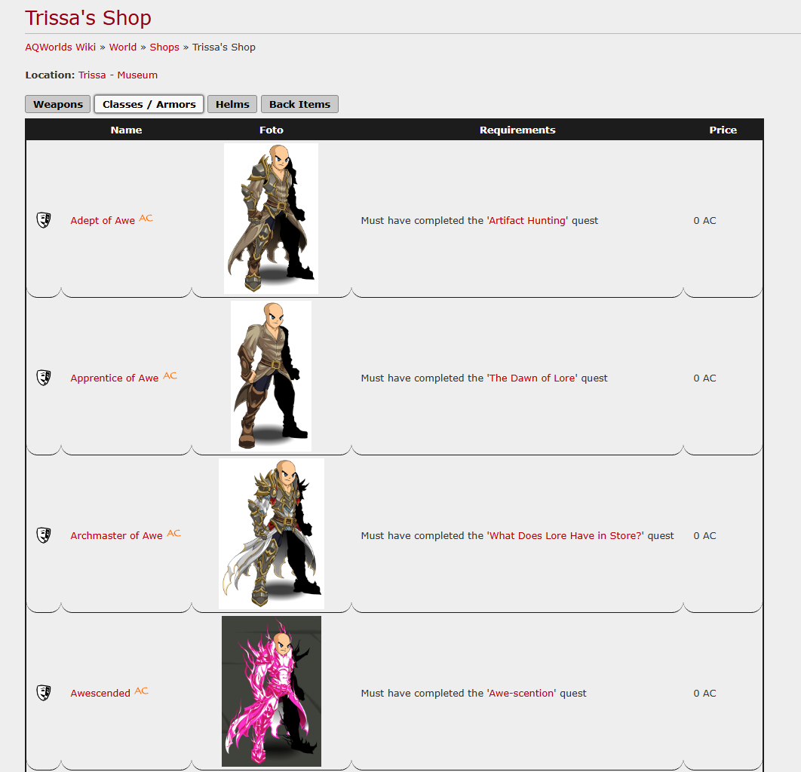

# AQW Wiki · Item Preview

**Mirá las imágenes de los objetos directamente en las tiendas y enlaces de AQW Wiki.**

[](https://github.com/GermanBartoli/aqw-wiki-item-preview)
[](https://github.com/GermanBartoli/aqw-wiki-item-preview/actions/workflows/ci.yml)

[Descargas](https://github.com/GermanBartoli/aqw-wiki-item-preview/releases) · [Empezar](#primeros-pasos) · [Mapa del repositorio](#mapa-del-repositorio) · [Autoría](#autoría-de-esta-documentación)



## Primeros pasos

1. Descargá el ZIP indicado en Descarga y cargá la carpeta descomprimida en Chrome.
2. Abrí una tienda de AQW Wiki con columnas Name y Price: aparecerá la columna Foto.
3. Apuntá a un enlace de objeto para ver su imagen; la extensión reutiliza la información mientras la pestaña siga abierta.

## Referencia y detalles


Extensión de Chrome que muestra imágenes de objetos en las tablas de [AQW Wiki](https://aqwwiki.wikidot.com/) y al dejar el mouse sobre sus enlaces. Por ejemplo, en [Trissa's Shop](https://aqwwiki.wikidot.com/trissa-s-shop) aparece una columna **Foto** junto a [Adept of Awe](https://aqwwiki.wikidot.com/adept-of-awe).

## Ejemplo

| Enlace en la tienda |
| --- |
|  |

La primera captura muestra la extensión en la pestaña **Classes / Armors** de Trissa's Shop. La columna **Foto** presenta las imágenes en un área de **200 × 200 px**.

## Qué hace

- Reconoce enlaces de artículos dentro del contenido de la wiki, incluso en pestañas de tiendas.
- Añade una columna **Foto** con imágenes de **200 × 200 px** a las tablas de objetos con **Name** y **Price**. Carga todas las miniaturas, incluso en pestañas ocultas, con hasta tres consultas simultáneas.
- Consulta el artículo enlazado tras una pausa de 250 ms y muestra la primera imagen del objeto.
- Omite iconos de AC, rareza y categorías, además de páginas que no son fichas de objetos.
- Oculta la imagen al salir del enlace o desplazar la página. Conserva resultados en memoria durante la pestaña.

## Descarga

Descargá `aqw-wiki-item-preview-1.1.0.zip` desde el [release v1.1.0](https://github.com/GermanBartoli/aqw-wiki-item-preview/releases/tag/v1.1.0). Es una extensión descomprimida de Chrome, no un instalador.

## Instalación

1. Descargá el ZIP del release y descomprimilo.
2. Abrí `chrome://extensions` y activá **Modo desarrollador**.
3. Pulsá **Cargar descomprimida** y elegí la carpeta extraída.
4. Abrí o recargá una página de AQW Wiki.

## Desarrollo

Requiere Node.js 22 o posterior y PowerShell para generar el ZIP. No hay paquetes que instalar.

```sh
npm test
npm run build
npm run package
```

`dist/` es la carpeta para **Cargar descomprimida**. `releases/` contiene el ZIP. Ver [arquitectura](docs/arquitectura.md) y [verificación](docs/verificacion.md).

```text
src/core/           Selección de enlaces e imágenes
src/content/        Vista flotante, columna de fotos y caché compartida
assets/             Iconos de la extensión
tests/              Pruebas del analizador
scripts/            Build, iconos y paquete ZIP
docs/               Arquitectura, verificación e imágenes
.github/workflows/  Verificación automática
```

## Privacidad y límites

No requiere cuenta, configuración ni permisos fuera de `aqwwiki.wikidot.com`. La extensión no guarda datos ni usa telemetría. Consulta los artículos enlazados en las tablas de objetos al abrir la página y los demás al apuntar a sus enlaces. Carga las imágenes desde los hosts que esos artículos utilizan.

La selección usa la estructura actual de las fichas de AQW Wiki. Una página sin imagen útil, una imagen caída o un cambio de formato en la wiki pueden dejar la vista previa vacía. No está publicada en Chrome Web Store ni es un producto oficial de AQW Wiki.

## Licencia y créditos

Código bajo licencia [MIT](LICENSE). Las capturas de AQW Wiki son material de referencia aportado para el proyecto; el contenido de la wiki indica [CC BY-SA 3.0](https://creativecommons.org/licenses/by-sa/3.0/) salvo indicación contraria. Las imágenes de los objetos permanecen en sus hosts originales.

## Mapa del repositorio

- [package.json](<package.json>)
- [LICENSE](<LICENSE>)
- [docs/arquitectura.md](<docs/arquitectura.md>)
- [docs/verificacion.md](<docs/verificacion.md>)

## Autoría de esta documentación

Repositorio mantenido por [Germán Bartoli](https://github.com/GermanBartoli). Guía revisada y actualizada con **Codex**, coautor de esta actualización documental. Los autores, colaboradores, licencias y recursos de terceros conservan sus créditos originales.

Los commits de esta revisión incluyen `Co-authored-by: Codex <noreply@openai.com>`; esta atribución no modifica la autoría del historial anterior.

<!-- firma-german-bartoli -->
<p align="center">
  <a href="https://germanbartoli.pages.dev/">
    <br />
    Hecho por Germán Bartoli · Ver portfolio
  </a>
</p>
